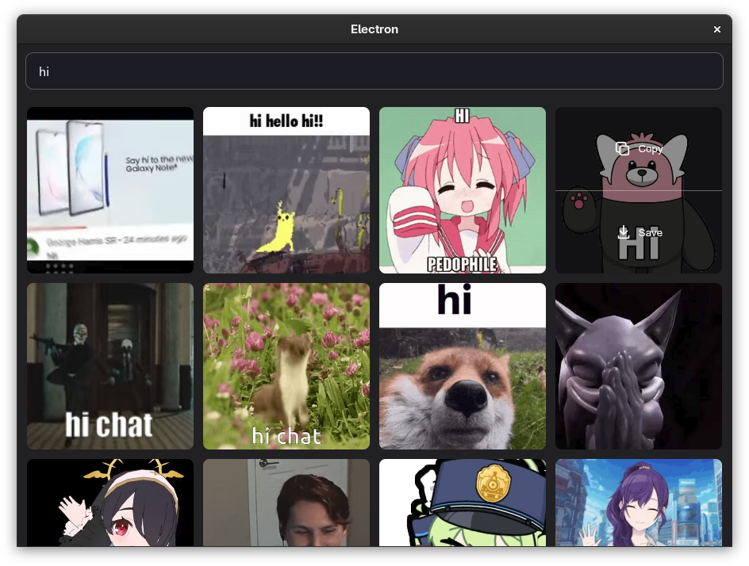

# pull-gif

Pulling gifs. Now only `gifbox.me` supported



## Project Setup

### Install

```bash
npm install
```

### Keys

Before dev / build, export API key for requests making

```bash
export GIFTBOX_API_KEY=`${YOUR_API_KEY}`
```

### Development

```bash
npm run dev
```

### Build

#### For windows

```bash
npm run build:win
```

#### For macOS

```bash
npm run build:mac
```

#### For Linux

```bash
npm run build:linux
```
